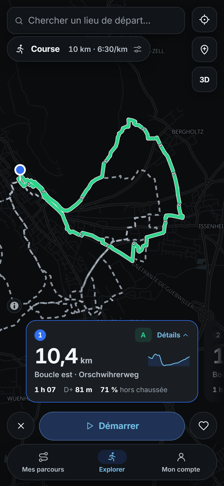
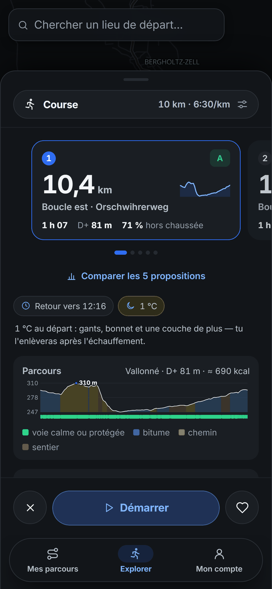
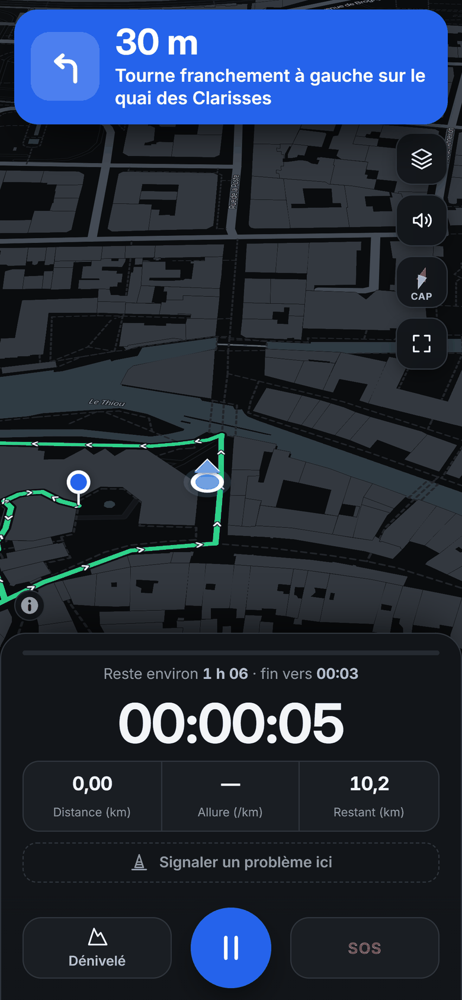
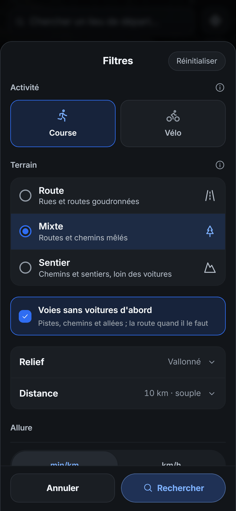
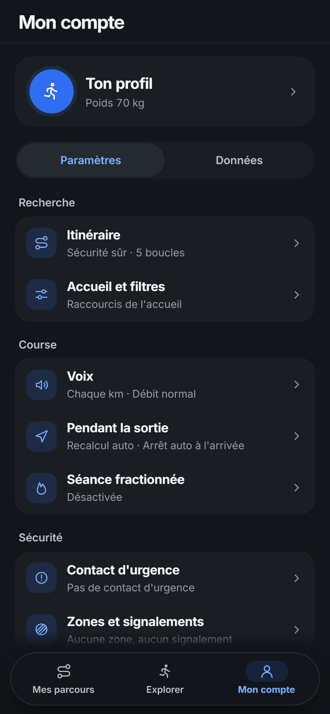
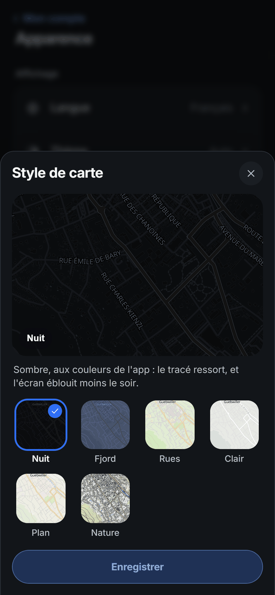
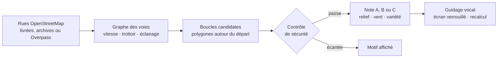

<div align="center">


# Lacet

[](https://github.com/ImShimao/lacet/releases/latest/download/Lacet.ipa)
[](#installation-)

[](https://github.com/ImShimao/lacet/actions/workflows/tests.yml)
[](https://github.com/ImShimao/lacet/actions/workflows/ios.yml)
[](#tests-)
[](LICENSE)
[](https://capacitorjs.com/)
[](https://maplibre.org/)
[](#limitations-connues-)
[](#comment-ça-marche-)

**Des boucles de course qui reviennent à ta porte — sans longer la nationale.**
Tu donnes une distance, Lacet propose des boucles notées A, B ou C sur leur
sécurité, puis te guide à la voix, écran verrouillé.

[**⬇️ Télécharger**](https://github.com/ImShimao/lacet/releases/latest) ·
[**📖 Documentation**](docs/README.md) ·
[**🐛 Signaler un bug**](https://github.com/ImShimao/lacet/issues/new)

</div>

---

## Aperçu 📸

<div align="center">

| Les boucles proposées | Le détail |
| :---: | :---: |
|  |  |

| En course | Les filtres | Les réglages | Les fonds de carte |
| :---: | :---: | :---: | :---: |
|  |  |  |  |

</div>

---

<a id="linstaller"></a>

## Installation ⬇️

Lacet n'est pas sur l'App Store. Un Mac de GitHub compile l'IPA à chaque envoi
sur `main` qui touche l'app, et chaque lundi avec les rues de la semaine ; elle
s'installe avec [SideStore](https://sidestore.io), sans Mac.

**Ce qu'il faut :** un iPhone sous iOS 15 ou plus (16.2 pour l'écran de
verrouillage), un PC Windows, et un identifiant Apple — un compte gratuit suffit.

1. **Sur l'iPhone : LocalDevVPN.** Installe-le depuis l'App Store, ouvre-le,
   touche **Connect** et autorise la configuration VPN avec ton code. Il doit
   être actif à chaque installation ou mise à jour.
2. **Sur le PC : iTunes et iloader.** iTunes et iCloud doivent venir du site
   d'Apple, pas du Microsoft Store. iloader (à trouver sur sidestore.io)
   installe SideStore sur l'iPhone et prépare le certificat et le fichier de
   couplage, en un clic.
3. **Ajouter la source de Lacet dans SideStore** (onglet **Sources**, **+**) :

   ```
   https://raw.githubusercontent.com/ImShimao/lacet/altstore/source.json
   ```

   Chaque compilation la met à jour : SideStore propose alors la nouvelle
   version, depuis n'importe où, sans le PC. Pour installer sans la source,
   ouvre avec SideStore le fichier `Lacet.ipa` de la
   [dernière publication](https://github.com/ImShimao/lacet/releases/latest).
4. *Sans internet, depuis le PC* : `python scripts/altstore_source.py` prépare
   le dossier `altstore/` à partir de `Lacet.ipa` posée à la racine, et
   `--autostart` le fait servir sur le port 8765 à chaque ouverture de session
   Windows. L'adresse est alors `http://<adresse du PC>:8765/source.json`.
5. **Faire confiance au profil** : **Réglages → Général → VPN et gestion de
   l'appareil** → ton identifiant → **Faire confiance**, puis **Confidentialité
   et sécurité → Mode développeur** → activer, et redémarrer.

Au premier lancement, accepte la position — **« Toujours »** quand iOS le
propose : c'est elle qui suit la sortie écran verrouillé — et les mouvements,
pour que le baromètre mesure le dénivelé.

**Mettre à jour :** dans SideStore, **Mes apps** → **Mettre à jour**. La
nouvelle version y apparaît quelques minutes après la fin de sa compilation.

> [!NOTE]
> L'IPA n'est pas signée. C'est SideStore qui la signe, avec ton identifiant
> Apple, au moment de l'installer. Elle est compilée sur GitHub depuis ce dépôt,
> par `.github/workflows/ios.yml`, et rien d'autre.

> [!IMPORTANT]
> **SideStore, pas Sideloadly.** Sideloadly signe l'app mais pas son extension, qui
> dessine l'écran de verrouillage : iOS l'ignore, et l'écran reste noir, sans un
> message. **Mon compte → Pendant la sortie** vérifie les cinq conditions d'une
> activité en direct et dit laquelle manque.

Le détail : [L'app iPhone](docs/app-iphone.md).

---

## Fonctionnalités ✨

| | |
| --- | --- |
| 🔁 **Des boucles** | Jusqu'à vingt propositions qui partent dans des directions différentes et reviennent à la porte : 10 km, un semi au mètre près, ou une durée. Chaque recherche en tire d'autres, dans un autre ordre |
| ➰ **La forme au choix** | Une boucle entière, deux boucles en « 8 » qui repassent à la porte, ou plusieurs tours d'une même boucle — ou laisser Lacet choisir |
| 🚸 **Le bon côté** | Au rond-point, on fait le tour du côté où l'on court : à gauche face aux voitures par défaut, comme le veut le code de la route ; la voix le dit en une phrase |
| 🛡️ **Note A, B ou C** | Chaque tronçon est jugé : vitesse de la voie, trottoir ou piste séparée, éclairage la nuit, traversées protégées. Ce qui ne passe pas est écarté, et l'app dit pourquoi |
| 📈 **Bande de parcours** | Profil et sécurité sur le même axe : savoir qu'il y a 200 m d'exposition ne sert à rien tant qu'on ignore *où* |
| 🗣️ **Guidage vocal** | Chaque virage annoncé deux fois, à l'avance puis au moment d'agir, en baissant la musique le temps de parler — écran verrouillé aussi |
| 🔒 **Écran de verrouillage** | Une activité en direct garde la consigne, sa distance et l'heure d'arrivée lisibles, Dynamic Island comprise |
| 🧭 **Recalcul** | Vingt secondes hors du tracé, et un nouveau chemin part d'où tu es, calculé sur le téléphone, en tenant la distance prévue plutôt qu'en ramenant au plus près |
| 📴 **Sans réseau** | Les rues d'Alsace sont livrées avec l'app ; ailleurs, elles se téléchargent une fois et restent. Le fond de carte se garde parcours par parcours |
| 🌳 **Parcs et bords de l'eau** | À sécurité égale, les boucles préfèrent les parcs, les bois, l'eau et les sentiers balisés — sans rien céder sur la note |
| 🌬️ **Vent et relief** | Le dernier tiers se court vent dans le dos quand il souffle à plus de 12 km/h ; plat, vallonné, côtes ou un D+ précis se choisit dans les filtres, avec un badge qui dit d'avance si le terrain autour s'y prête |
| 📍 **Passer par un point** | Un parc, une fontaine : toutes les boucles y passent, notées comme les autres |
| 🚫 **Zone à éviter** | Un cercle de 100 m à 2 km que les boucles et le recalcul contournent, gardé d'une recherche à l'autre |
| 🎥 **Survol 3D** | La boucle survolée sur le relief avant de partir, dix-sept secondes pour 10 km |
| 🏁 **Ce que tu as couru** | Distance, allure, dénivelé, ta trace réelle, exportée en GPX horodaté pour une montre ou Strava |
| 🤝 **Partager une boucle** | « Partager » l'envoie en GPX ; un ami qui a Lacet l'ouvre avec l'app. Tout GPX importé est analysé comme une boucle de Lacet : rues reconnues, note A, B ou C, types de voie, revêtement, traversées, dénivelé et consignes vocales |
| 💧 **Points d'eau** | Ceux qui bordent la boucle s'affichent, et la voix prévient cent mètres avant |
| 🆘 **SOS** | Un bouton prépare un SMS avec ta position ; un proche peut recevoir l'heure prévue du retour |
| 🚴 **Course ou vélo** | Allure en min/km ou vitesse en km/h, pause automatique aux feux ; à vélo, la voix donne les kilomètres tous les 5 km |
| 🎨 **Apparence** | Thème sombre, clair ou celui de l'iPhone, quatre couleurs d'accent, texte agrandi, huit fonds de carte en vignettes |
| ⚙️ **Réglages en lignes** | Une ligne par réglage, sa valeur et un menu : voix, débit, anticipation des consignes, recalcul et arrivée automatiques, sécurité, direction, forme, voies à éviter |
| 📝 **Rapport de sortie** | Depuis le bilan, un fichier JSON — trace, voix, précision du GPS, recalculs, réglages — pour comprendre une sortie qui s'est mal passée |
| 🙈 **Rien ne part** | Pas de compte, pas de serveur, pas de suivi : favoris, sorties et réglages restent sur le téléphone |

### Les gestes sur la carte 👆

La carte occupe tout l'écran ; presque tout se fait au doigt, dessus.

| Geste | Effet |
| --- | --- |
| Glisser le repère | Déplacer le départ |
| Appui long | Poser un fanion : les boucles passent par ce point |
| Cercle hachuré, puis toucher | Poser le centre d'une zone à éviter ; glisser sa poignée la déplace |
| Toucher une boucle en pointillés | La mettre en avant |
| Toucher la carte de parcours | Déplier le détail ; la poignée grise le replie |
| Parcourir la bande du doigt | Allumer le point correspondant sur la carte, le détail s'effaçant le temps du geste |
| Toucher une consigne de la feuille de route | Replier le détail et amener la carte sur le virage |
| Glisser une ligne de « Mes parcours » vers la gauche | Renommer ou retirer un favori ou une sortie |
| En course : tourner ou déplacer la carte | La libérer du suivi ; **Recentrer** la reprend, pincer ne libère rien |
| Pendant le survol 3D : toucher | Pause, puis reprise ; glisser l'arrête |

**Terminer** n'apparaît qu'en pause : un doigt qui glisse n'arrête pas la sortie.

---

## Comment ça marche 🔧

**Tout tourne sur le téléphone.** L'interface est une page React et MapLibre
emballée par Capacitor ; le moteur, en JavaScript, s'exécute dans un *worker*
pour ne pas figer la carte. Il va chercher lui-même les rues, l'altitude à
l'IGN et le vent chez Open-Meteo. Rien à héberger, aucune clé d'API.



**Un moteur de référence en Python** (`backend/`) garde la justification et le
test de chaque seuil. Le moteur JavaScript en est le portage, et la CI exige des
deux, sur 19 cas figés, le même graphe, les mêmes candidats arête par arête et
la même réponse, à 1e-9 près. Un portage subtilement faux proposerait un « A »
là où il faudrait un « C », et rien à l'écran ne le montrerait. D'où
`engine/py.js`, qui reproduit l'arithmétique de CPython jusqu'au modulo flottant
et à l'arrondi au pair.

**L'IPA se compile sur un Mac de GitHub**, parce que Xcode n'existe que sur
macOS. Le dossier `ios/` n'est pas versionné : il est régénéré à chaque fois,
et tout ce qui distingue Lacet d'un projet Capacitor vierge tient dans
`frontend/ios-overlay/`. L'IPA part dans une publication `v<version>` plutôt
qu'en artefact, que GitHub efface au bout de quelques jours.

<details>
<summary><b>Architecture du code</b></summary>

```
frontend/
├── src/                     L'interface React, à plat : écrans, hooks use*.js
│   ├── App.jsx              Le départ, les propositions, les onglets
│   ├── MapView.jsx          La carte : tracés, zones à éviter, survol 3D
│   ├── LiveRun.jsx          La sortie : consignes, voix, hors-parcours
│   ├── native.js            Le pont vers l'iPhone : GPS, voix, activité en direct
│   ├── styles/NN-*.css
│   └── engine/              Le moteur, dans un worker (worker.js, appelé par client.js)
│       ├── overpass.js, archive.js, tilestore.js, region.js   Les rues
│       ├── graph.js, weights.js, dijkstra.js                  Le graphe et son coût
│       ├── loops.js, safety.js, service.js                    Les boucles, leur note (planLoops)
│       ├── reroute.js, navigation.js, matcher.js              Recalcul, consignes, suivi
│       ├── py.js                                              L'arithmétique de CPython
│       └── parity.test.js                                     Le JS face à la référence
├── ios-overlay/
│   ├── customize.py         Autorisations, GPS et voix en arrière-plan, session audio
│   ├── add_live_activity.rb Greffe l'extension de l'écran verrouillé au projet Xcode
│   └── live-activity/       L'extension, et les plugins Swift : voix, baromètre, boussole
└── scripts/                 Rues de la région, mesure des boucles, icônes
backend/
├── app/                     Le moteur de référence : osm/, routing/, safety/,
│                            elevation.py, wind.py, solar.py, service.py (plan_loops)
├── tests/                   395 tests sur des damiers synthétiques
└── scripts/                 parity_dump.py (l'oracle), smoke.py (essai réel)
scripts/altstore_source.py   Prépare et fait servir la source de l'app (SideStore)
docs/                        La documentation, un fichier par thème
.github/workflows/           tests.yml (Linux, à chaque envoi) · ios.yml (l'IPA, sur macOS)
```

Le détail : [Comment c'est fait](docs/architecture.md),
[La sécurité](docs/securite.md), [La génération des boucles](docs/generation.md).

</details>

---

## Limitations connues ⚠️

* **L'app ne garantit pas la sécurité.** Elle privilégie les voies protégées
  d'après OpenStreetMap, dont les données peuvent être incomplètes ou dépassées,
  et un chantier peut apparaître. L'interface le dit, et doit continuer à le dire.
* **iPhone seulement, en portrait.** Sur iPad, iOS l'ouvre en mode iPhone. Rien
  pour Android.
* **Avec un compte Apple gratuit, l'app expire au bout de 7 jours.** SideStore la
  renouvelle depuis le téléphone, tant que LocalDevVPN est actif. Trois apps
  actives au plus, et l'extension en compte une : Lacet en prend deux. Seul un
  compte développeur payant (99 € par an) supprimerait le renouvellement.
* **Pas d'Apple Santé.** SideStore ne signe l'app qu'avec les autorisations de son
  profil, et HealthKit refuserait tout sans erreur visible. L'envoi direct vers
  Strava a été retiré : exporte la sortie en GPX, puis importe-la sur le site de
  Strava (« Téléverser une activité »).
* **Les rues livrées ne couvrent que l'Alsace et ses abords.** Les archives en
  ligne couvrent la France, la Suisse, le Benelux, l'Autriche, le Portugal et
  des régions d'Allemagne, d'Italie et d'Espagne ; ailleurs, les rues viennent
  d'Overpass, une ressource publique partagée. Dans tous les cas, la première
  recherche d'une zone demande du réseau.
* **Une carte hors ligne pèse lourd en ville** : une quinzaine de mégaoctets pour
  une boucle de 10 km en plein centre, contre un ou deux à la campagne. Un
  plafond de 40 Mo par parcours empêche que ça dérape.
* **Les fonds gratuits** viennent d'OpenFreeMap (usage commercial autorisé) et
  d'OpenTopoMap. Le satellite et les fonds Mapbox demandent une clé publique
  (`VITE_MAPBOX_TOKEN`). Le détail par service est dans
  [limites.md](docs/limites.md).
* **L'aperçu dans un navigateur n'a ni GPS, ni voix, ni baromètre**, ni écran de
  verrouillage : ils n'existent que dans l'app installée.

La liste complète, et ce qui vient ensuite : [Limites et suite](docs/limites.md).

---

## Développement 🚀

Prérequis : [Node.js](https://nodejs.org/) 22 (Capacitor 8 l'exige) et
Python 3.13. Les commandes sont écrites pour Git Bash sous Windows, depuis la
racine du dépôt.

```bash
git clone https://github.com/ImShimao/lacet.git
cd lacet
(cd frontend && npm install)
(cd backend && python -m venv .venv && .venv/Scripts/python.exe -m pip install -r requirements-dev.txt)
(cd frontend && npm run dev)
```

L'aperçu tourne sur http://127.0.0.1:5173. Ouvre-le à taille de téléphone
(390 × 844) : l'app n'a qu'une mise en page, celle de l'iPhone tenu droit.

### Tests 🧪

Les tests sont à côté du code (`foo.js` → `foo.test.js`) côté app, dans
`backend/tests/` côté Python. GitHub relance les deux suites, l'oracle de parité,
le build et les parcours Playwright à chaque envoi (`.github/workflows/tests.yml`).

| Commande | Couverture |
| --- | --- |
| `(cd frontend && npm test)` | 848 tests, 71 fichiers : le moteur JavaScript, l'interface sous jsdom, et des sorties entières écoutées consigne par consigne (`LiveRun.voice.test.jsx`) |
| `(cd frontend && npx vitest run src/engine/parity.test.js)` | Le JavaScript face à Python sur 19 cas figés : même graphe, mêmes candidats, même réponse à 1e-9 près |
| `(cd backend && .venv/Scripts/python.exe -m pytest)` | 395 tests, 16 fichiers, hors ligne et déterministes |
| `(cd frontend && npm run test:e2e)` | 4 parcours dans Chromium à taille d'iPhone : ce que jsdom ne voit pas (un menu passé sous une ligne, une feuille qui déborde) |
| `(cd backend && .venv/Scripts/python.exe scripts/parity_dump.py --check)` | Dit, sans rien écrire, si l'oracle de parité est à jour |
| `(cd backend && .venv/Scripts/python.exe -X utf8 scripts/smoke.py annecy 8)` | Essai réel : appelle OpenStreetMap, montre les boucles retenues **et** celles écartées, avec leur motif |

Changer un calcul partagé, c'est modifier Python **et** JavaScript, relancer
`scripts/parity_dump.py` (sans `--check`) pour refaire l'oracle, puis
`parity.test.js`. Un oracle oublié fait échouer la CI.

### Compiler 📦

```bash
(cd frontend && npm run build)
```

Le dossier `frontend/dist/`, que Capacitor emballe. L'IPA, elle, ne se compile
que sur GitHub — à chaque envoi sur `main` qui touche `frontend/`, ou à la
demande :

```bash
gh workflow run ios.yml
```

```bash
gh run list --workflow ios.yml
```

Une compilation prend de trois à dix minutes, tests compris, et pose l'IPA dans
la publication `v<version>` : 1.1.8 pour la compilation 108, 1.2.0 pour la 200
(`scripts/version.py`). La source SideStore suit, sur la branche `altstore`.

<details>
<summary><b>Pièges connus</b></summary>

* **Servir `altstore/`, jamais la racine du dépôt.** Servie telle quelle, elle
  livrait à tout le Wi-Fi le dossier `.git` et le moindre `.env`. Si
  `--autostart` n'est pas posé, sers le dossier à la main :
  `python -m http.server 8765 --directory altstore`.
* **Un serveur lancé depuis un terminal meurt avec lui**, et « Mettre à jour »
  échoue alors sur une simple erreur réseau. C'est pour ça que `--autostart`
  pose un lanceur dans le dossier Démarrage de Windows.
* **« The downloaded version does not match the version specified by the
  source »** : la version annoncée doit être exactement le
  `CFBundleShortVersionString` de l'IPA. Le script la lit dans le paquet ; ne la
  retouche pas à la main.
* **L'aperçu lit d'autres rues que l'app** quand `frontend/public/region/` manque
  ou date : ce dossier n'est pas versionné. Reprends celui de la dernière IPA :
  `unzip -o -j Lacet.ipa 'Payload/Lacet.app/public/region/*' -d frontend/public/region`
* **`smoke.py` plante sous Git Bash** sur `UnicodeEncodeError` sans `-X utf8` :
  sa sortie contient des caractères que la page de code de Windows ne connaît pas.
* **Une compilation verte ne prouve pas l'écran de verrouillage.** `ios.yml`
  vérifie donc sur le paquet construit que l'extension est rattachée à l'app,
  porte sa version, et que l'Info.plist déclare les activités en direct.

</details>

---

## Contribuer 🤝

Les retours passent par une [issue](https://github.com/ImShimao/lacet/issues).
Le code est public pour être lu, pas repris : le copier, le modifier ou le
redistribuer demande l'accord de l'auteur ([licence](LICENSE)).

Avant de proposer une PR, vérifie que `npm test`, `pytest` et
`parity_dump.py --check` passent. Les commentaires, les tests et les messages
de commit sont en français, les identifiants en anglais ; un message de commit
dit l'effet visible (« La voix dit « troisième kilomètre », pas « ce
kilomètre » »).

---

<div align="center">

Code lisible, pas réutilisable : [tous droits réservés](LICENSE) · Fait avec React, MapLibre et
[Capacitor](https://capacitorjs.com/) par [**ImShimao**](https://github.com/ImShimao)

<sub>Rues © [contributeurs OpenStreetMap](https://www.openstreetmap.org/copyright) (ODbL),
servies par Overpass et [lacet-data](https://github.com/ImShimao/lacet-data) ·
fonds de carte © OpenFreeMap, © OpenMapTiles, © OpenTopoMap, © Mapbox · altitudes IGN RGE ALTI
et Valhalla (FOSSGIS) · relief Mapzen / Copernicus EU-DEM · recherche de lieux Photon
(Komoot) et Nominatim · vent Open-Meteo</sub>

</div>
