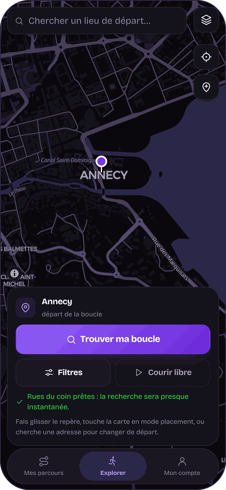
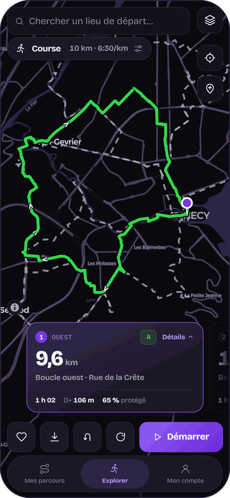
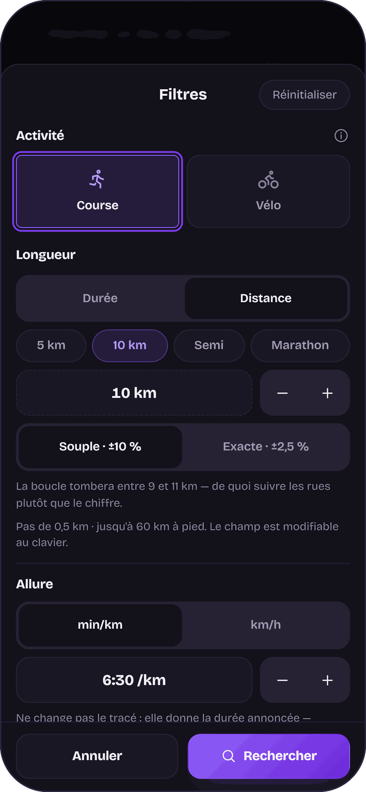
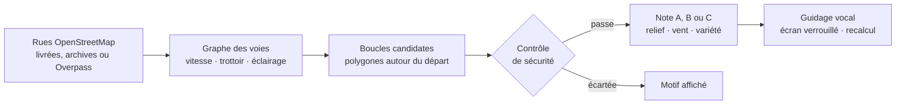

<p align="center">
  
</p>

<h1 align="center">Lacet</h1>

<p align="center">
  <b>Des boucles de course qui reviennent à ta porte — sans longer la nationale.</b>
</p>

<p align="center">
  <a href="https://github.com/ImShimao/lacet/actions/workflows/tests.yml"></a>
  <a href="https://github.com/ImShimao/lacet/actions/workflows/ios.yml"></a>
  <a href="https://github.com/ImShimao/lacet/releases/latest"></a>
  
  
</p>

<p align="center">
  <a href="https://github.com/ImShimao/lacet/releases/latest/download/Lacet.ipa"><b>Télécharger l'IPA</b></a>
  ·
  <a href="#linstaller">Guide d'installation</a>
  ·
  <a href="docs/README.md">Documentation</a>
</p>

<br>

<p align="center">
  
  &nbsp;
  
  &nbsp;
  
  &nbsp;
  
</p>

<p align="center"><sub>Choisir le départ · recevoir des boucles notées · lire le détail · régler la sortie</sub></p>

<br>

Tu sors courir 10 km. Tu ne veux pas réfléchir à l'itinéraire, tu ne veux pas
finir sur un bas-côté à 80 km/h, et tu veux revenir chez toi. Lacet fait ça :
tu donnes une distance, il propose des boucles, il te dit lesquelles sont sûres,
et il te guide à la voix pendant que tu cours.

## Ce qu'il fait

- **Des boucles, pas des allers-retours.** Jusqu'à douze propositions par
  recherche, dans des directions différentes, à la distance demandée — 10 km,
  un semi au mètre près, ou une durée.
- **Une note de sécurité, A, B ou C.** Chaque tronçon est jugé : vitesse de la
  voie, trottoir ou piste séparée, éclairage la nuit, traversées protégées. Ce
  qui ne passe pas le contrôle est écarté, et l'app dit pourquoi.
- **Un guidage comme un GPS.** La carte suit ta course, le prochain virage
  s'affiche en grand, et la voix l'annonce en baissant ta musique — écran
  verrouillé aussi, avec une activité en direct.
- **Un nouveau chemin si tu t'écartes.** Un virage raté, une rue barrée : il
  recalcule depuis là où tu es, sur le téléphone, en tenant la distance prévue.
- **Sans réseau.** Les rues d'Alsace sont livrées avec l'app ; ailleurs, elles
  se téléchargent une fois et restent, comme le fond de carte de tes parcours.
- **Ce que tu as couru.** Distance, allure, temps au kilomètre, dénivelé, ta
  trace réelle — exportable en GPX pour une montre ou Strava.
- **Course ou vélo**, pause automatique aux feux, points d'eau le long du
  tracé, départs enregistrés, bouton SOS qui prépare un SMS avec ta position.
- **Rien ne part.** Pas de compte, pas de serveur, pas de suivi : tout se
  calcule et se garde sur le téléphone.

Le détail, et le pourquoi de chaque choix : [Ce que fait Lacet](docs/fonctionnalites.md).

## L'installer

Lacet n'est pas sur l'App Store : il se compile tout seul sur GitHub, à chaque
envoi sur `main` et chaque lundi avec les rues de la semaine, et s'installe avec
[AltStore](https://altstore.io) — pas besoin de Mac.

**Ce qu'il faut :** un iPhone sous iOS 16.2 ou plus, un PC sur le même Wi-Fi, et
un identifiant Apple — un compte gratuit suffit.

1. **AltServer sur le PC.** Télécharge-le sur [altstore.io](https://altstore.io).
   Sous Windows, iTunes et iCloud doivent venir du site d'Apple, pas du
   Microsoft Store.
2. **AltStore sur l'iPhone.** iPhone branché au PC, clique sur l'icône
   d'AltServer dans la barre des tâches → *Install AltStore* → ton iPhone.
3. **La dernière version de Lacet**, posée à la racine du dépôt :

   ```bash
   gh release download --repo ImShimao/lacet --pattern Lacet.ipa --clobber
   ```

   Ou le lien [Télécharger l'IPA](https://github.com/ImShimao/lacet/releases/latest/download/Lacet.ipa),
   et chaque version a sa page dans [Releases](https://github.com/ImShimao/lacet/releases).
4. **La source AltStore.** Le PC prépare le dossier `altstore/`, puis le sert sur
   le réseau local — ce dossier-là seulement :

   ```bash
   python scripts/altstore_source.py
   ```

   ```bash
   python -m http.server 8765 --directory altstore
   ```

   Sur l'iPhone : **AltStore → Sources → +** → l'adresse que le script affiche
   (`http://<adresse du PC>:8765/source.json`) → **Lacet → Installer**. Pour que
   le PC la serve tout seul à chaque démarrage :

   ```bash
   python scripts/altstore_source.py --autostart
   ```
5. **Faire confiance au profil.** **Réglages → Général → VPN et gestion de
   l'appareil** → ton identifiant → **Faire confiance**, puis **Confidentialité et
   sécurité → Mode développeur** → activer, et redémarrer.

Au premier lancement, accepte la position — **« Toujours »** si iOS le propose :
c'est elle qui suit la sortie écran verrouillé — et les mouvements, pour que le
baromètre mesure le dénivelé.

**Mettre à jour.** Une nouvelle version remplace `Lacet.ipa` (étape 3), le
script refait la source (étape 4), et AltStore propose **Mettre à jour**.

**Bon à savoir**

- Avec un compte Apple gratuit, l'app expire au bout de **7 jours** ; AltStore la
  renouvelle tout seul tant qu'AltServer tourne sur le même Wi-Fi.
- Trois apps actives au plus, et l'écran de verrouillage en compte une : Lacet en
  prend deux.
- **AltStore, pas Sideloadly** : Sideloadly ne signe pas l'extension qui dessine
  l'écran de verrouillage, et celui-ci reste noir, sans un message.
- Écran de verrouillage vide ? **Mon compte → Pendant la sortie** vérifie les
  cinq conditions et dit laquelle manque.

Tout le détail : [L'app iPhone](docs/app-iphone.md).

## Comment ça marche

Tout tourne sur le téléphone : une interface React et MapLibre emballée par
Capacitor, et un moteur JavaScript qui s'exécute dans un *worker*. Rien à
héberger, rien à payer, aucune clé d'API.



Le moteur JavaScript est le portage d'une **référence en Python** (`backend/`),
où chaque seuil est justifié et testé. À chaque envoi, la CI exige des deux le
même graphe, les mêmes candidats arête par arête et la même réponse, à 1e-9
près : un portage subtilement faux proposerait un « A » là où il faudrait un
« C », et rien à l'écran ne le montrerait.

```
frontend/              l'app : React + MapLibre, et le moteur (src/engine/)
frontend/ios-overlay/  ce qui distingue Lacet d'un projet Capacitor vierge
backend/               le moteur de référence, en Python
docs/                  la documentation, section par section
.github/workflows/     les tests sur Linux, l'IPA sur un Mac de GitHub
```

Plus de détails : [Comment c'est fait](docs/architecture.md),
[La sécurité](docs/securite.md), [La génération des boucles](docs/generation.md).

## Développer

```bash
(cd frontend && npm install)
(cd frontend && npm run dev)
(cd frontend && npm test)
(cd backend && .venv/Scripts/python.exe -m pytest)
```

L'aperçu tourne sur http://127.0.0.1:5173, à taille de téléphone — sans GPS ni
voix, qui n'existent que dans l'app. Node 22 ou plus. L'environnement Python,
l'aperçu dans VS Code et la parité des deux moteurs : [Développer](docs/developper.md).

## Documentation

- [Ce que fait Lacet](docs/fonctionnalites.md) · [L'interface et les réglages](docs/interface.md) — ce qui se voit, et ce qui se règle
- [La sécurité](docs/securite.md) · [La génération des boucles](docs/generation.md) — comment un tronçon est jugé, comment les boucles naissent
- [Le guidage et la sortie](docs/guidage.md) · [L'app iPhone](docs/app-iphone.md) — les consignes, le hors-parcours, ce que le natif ajoute
- [Comment c'est fait](docs/architecture.md) · [Performances](docs/performances.md) — l'architecture, et ce qu'elle coûte
- [Développer](docs/developper.md) · [Limites et suite](docs/limites.md) — travailler sur le projet, et ce qu'il ne sait pas faire

## Données et crédits

Rues © [contributeurs OpenStreetMap](https://www.openstreetmap.org/copyright)
(ODbL), servies par Overpass et les archives de
[lacet-data](https://github.com/ImShimao/lacet-data) · fonds de carte © CARTO,
© OpenFreeMap, © Esri, © OpenTopoMap · altitudes IGN RGE ALTI et Valhalla
(FOSSGIS) · recherche de lieux Photon (Komoot) et Nominatim · vent Open-Meteo.
